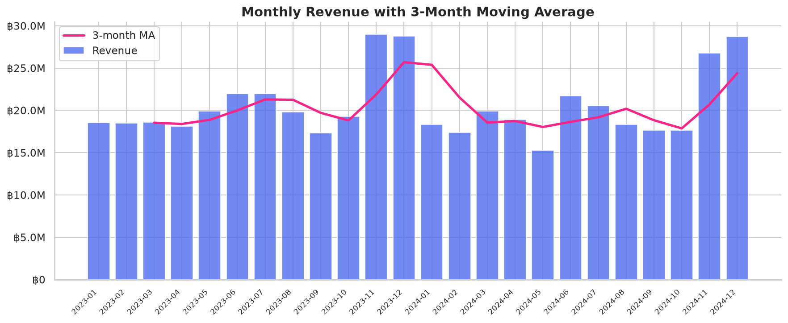
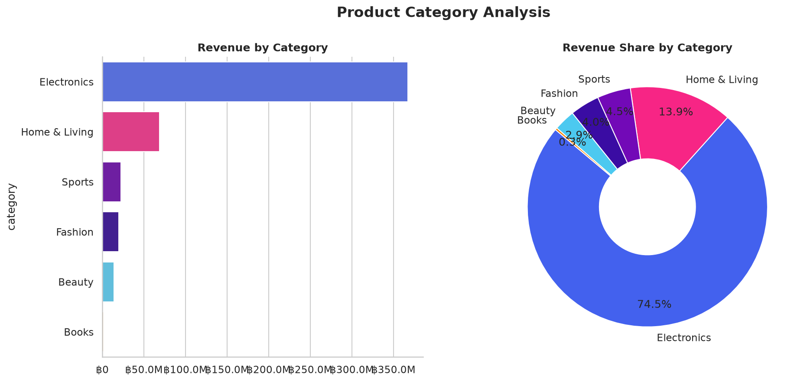
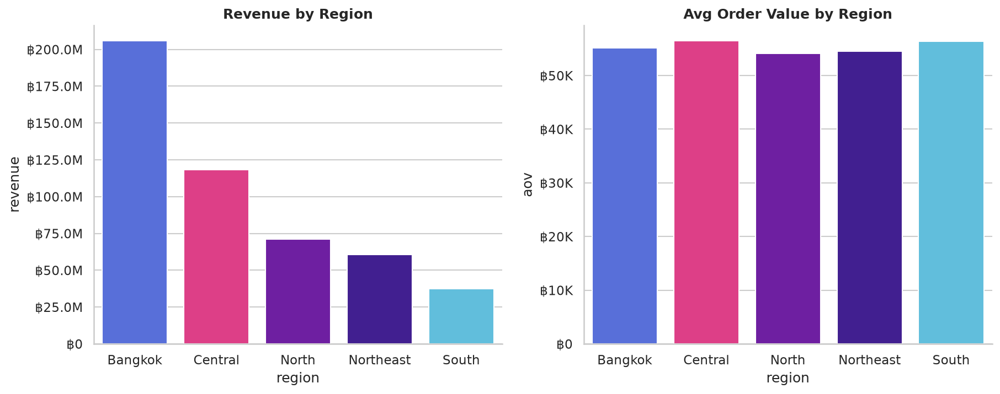
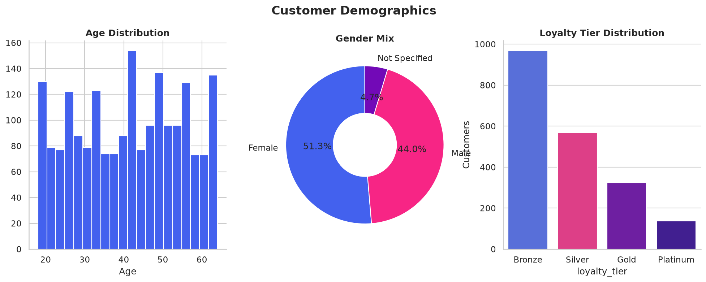
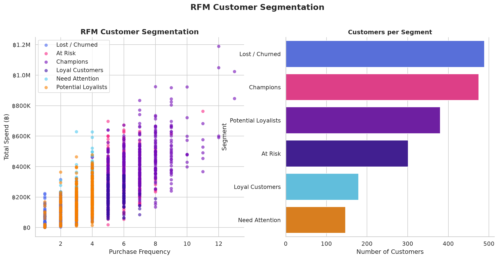
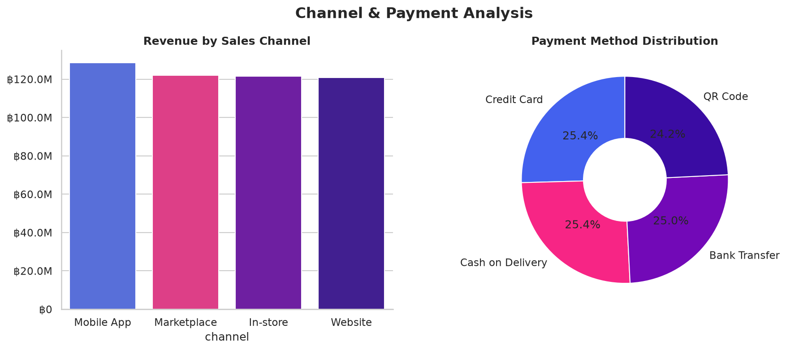

# E-Commerce Sales Analysis 🛒

> **Data Analysis Portfolio Project** | Python · SQL · Plotly · Matplotlib  
> **Dataset:** 15,000 orders · 2,000 customers · 150 products · 2023–2024

---

## Overview

This project demonstrates end-to-end data analysis skills through a realistic e-commerce sales dataset. The analysis covers everything from raw data ingestion and cleaning through exploratory analysis, SQL queries, customer segmentation (RFM), and an interactive Plotly-Dash dashboard.

**Key KPIs discovered:**
- Total Revenue: **~THB 493M** across 2 years
- Average Order Value: **~THB 55,331**
- Unique Active Customers: **1,971**
- Peak Season: **November–December** (45% higher revenue vs. average)

---

## Project Structure

```
ecommerce-sales-analysis/
├── data/
│   ├── raw/                   # Generated CSV files (gitignored)
│   │   ├── customers.csv
│   │   ├── products.csv
│   │   ├── orders.csv
│   │   └── order_items.csv
│   └── processed/             # Cleaned / transformed data
├── notebooks/
│   └── 01_eda_full_analysis.ipynb   # Main analysis notebook
├── sql/
│   └── queries.sql            # 10 production-ready SQL queries
├── src/
│   ├── generate_data.py       # Synthetic data generator
│   ├── eda.py                 # Shared EDA utilities & helpers
│   └── analysis.py            # Script version of full analysis
├── dashboard/
│   └── dashboard.py           # Interactive Plotly-Dash dashboard
├── reports/
│   ├── 01_monthly_revenue.png
│   ├── 02_category_revenue.png
│   ├── 03_regional_performance.png
│   ├── 04_customer_demographics.png
│   ├── 05_rfm_segmentation.png
│   └── 06_channel_payment.png
├── requirements.txt
└── README.md
```

---

## Analyses Performed

| # | Analysis | Methods | Output |
|---|----------|---------|--------|
| 1 | **Revenue Trend** | Time-series, 3-month MA | `01_monthly_revenue.png` |
| 2 | **Category Breakdown** | Bar chart, Donut chart | `02_category_revenue.png` |
| 3 | **Regional Performance** | Grouped aggregation | `03_regional_performance.png` |
| 4 | **Customer Demographics** | Distribution analysis | `04_customer_demographics.png` |
| 5 | **RFM Segmentation** | Quartile scoring, cluster labelling | `05_rfm_segmentation.png` |
| 6 | **Channel & Payment Mix** | Proportion analysis | `06_channel_payment.png` |

---

## SQL Query Collection

[`sql/queries.sql`](sql/queries.sql) contains 10 production-ready queries:

1. Overview KPIs (revenue, AOV, return/cancellation rate)
2. Monthly Revenue Trend with MoM growth
3. Revenue by Category with window-function share
4. Top 10 Products by Revenue
5. Customer Cohort Retention Analysis
6. RFM Segmentation with NTILE scoring
7. Channel Performance Comparison
8. Regional Revenue Breakdown
9. Basket Size Distribution
10. Payment Method Mix

---

## Key Insights

| Insight | Recommendation |
|---------|----------------|
| Electronics & Fashion drive **45%+** of revenue | Increase ad spend on these categories |
| Revenue spikes **45% in Nov–Dec** | Plan inventory & promotions 6–8 weeks early |
| Bangkok generates **40%** of all orders | Expand same-day delivery footprint |
| **Champions** segment has 4x higher LTV | Reward with exclusive loyalty perks |
| **At-Risk** customers: 90+ days inactive | Trigger win-back email with 15% discount |
| Mobile App channel shows highest AOV | Prioritize app UX & push notifications |

---

## RFM Customer Segments

| Segment | Description | Action |
|---------|-------------|--------|
| **Champions** | Bought recently, frequently, spent most | Reward & ask for reviews |
| **Loyal Customers** | Regular buyers, good spend | Upsell premium products |
| **Potential Loyalists** | Recent buyers, not frequent yet | Nurture with onboarding sequence |
| **At Risk** | High frequency but hasn't bought recently | Win-back campaign |
| **Need Attention** | Below-average scores | Re-engagement offers |
| **Lost / Churned** | Low RFM across all dimensions | Low-cost reactivation or sunset |

---

## Setup & Usage

### 1. Install Dependencies
```bash
pip install -r requirements.txt
```

### 2. Generate Dataset
```bash
python src/generate_data.py
```

### 3. Run Full Analysis (saves charts to `reports/`)
```bash
python src/analysis.py
```

### 4. Launch Interactive Dashboard
```bash
python dashboard/dashboard.py
# → Open http://localhost:8050
```

### 5. Open Jupyter Notebook
```bash
jupyter lab notebooks/01_eda_full_analysis.ipynb
```

---

## Tech Stack

| Tool | Purpose |
|------|---------|
| **Python 3.11+** | Core language |
| **Pandas / NumPy** | Data manipulation |
| **Matplotlib / Seaborn** | Static visualizations |
| **Plotly / Dash** | Interactive dashboard |
| **SQL (SQLite-compatible)** | Query-based analysis |
| **Jupyter Lab** | Exploratory notebook |
| **scikit-learn** | (Extendable for ML models) |

---

## Charts Preview

### Monthly Revenue Trend


### Category Revenue Breakdown


### Regional Performance


### Customer Demographics


### RFM Segmentation


### Channel & Payment Analysis


---

## Author

**Data Analysis Portfolio**  
Skills: Python · SQL · Power BI / Tableau · Excel · Machine Learning · R  
Contact: [LinkedIn](https://linkedin.com) | [GitHub](https://github.com)

---

*Dataset is synthetically generated for portfolio purposes.*
